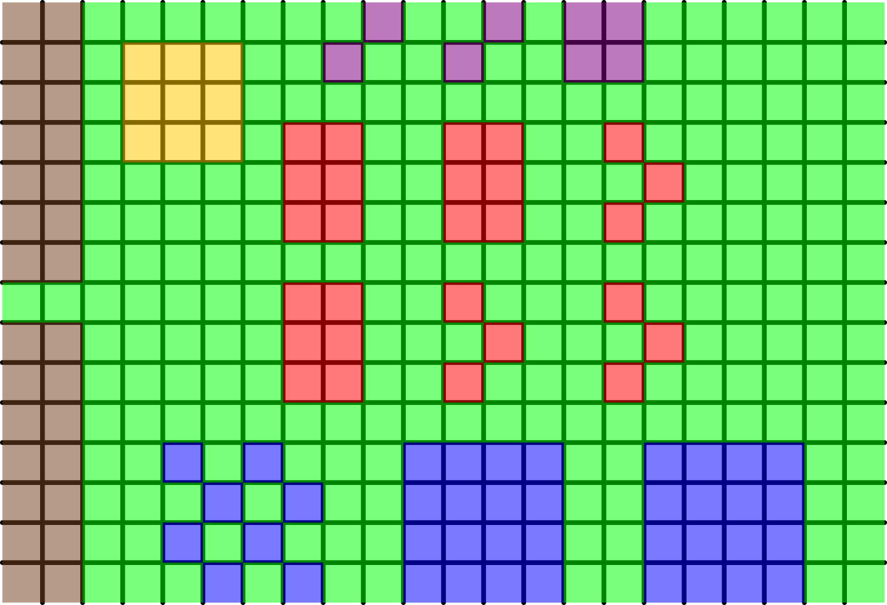
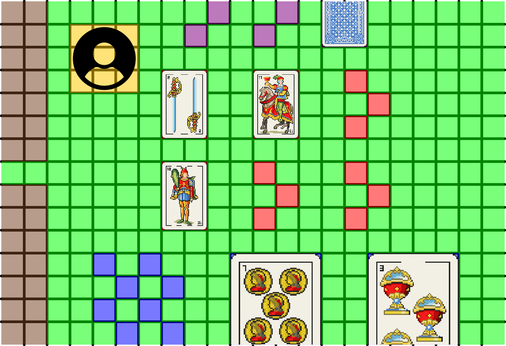

# TRUCO, COSAS PARA HACER

- Asignar imágenes a cartas
- Algún sistema de MessageBox para que el jugador pueda responder a lo que canta el rival
- Otro sistema de mensajes para que el rival pueda hablar
- Buscar/Diseñar imágenes 16bits para fondos, UI y rivales
- Buscar/Diseñar efectos de sonido
- Hacer pantalla de instrucciones
- Hacer pantalla de créditos (meter al todos los que correspondan)
- Configurar dificultad de distintos rivales

Links del profe para assets:

*En Open Game Art tienen gráficos que incluso es legal usarlos: https://opengameart.org/*

*También hay páginas con packs que son Creative Commons, como Kenney: https://www.kenney.nl/assets?q=2d*

*Para hacer diseños propios (es gratuita): Pixelorama (Pixelart + animación):*

*https://orama-interactive.itch.io/pixelorama (o imágenes generadas por IA).*

*En FreeSound idem pero para sonidos: https://freesound.org/search/?q=slap*

## COSAS PROPIAS QUE PIDEN DEL [TP](https://docs.google.com/document/d/e/2PACX-1vQu5k7bRILw3_aXlUjjMP0MTuwFi2QnWOf-BqMRihrfNNZRInp-t_Dwht9gDKmMU1CJ9zt2Axo6e871/pub)

- Hacer tests de "dominio" (no sé, lo dice el tp para el checkpoint1)
- Hacer diagrama de explicaciones teóricas: *Se busca que expliquen dónde y para qué aplicaron los conceptos del paradigma, justificando las decisiones que tomaron en el modelado. Mantenerlo enfocado, sin explayarse innecesariamente en generalidades. Sólo lo principal.*
- Hacer aún más tests...
- README explicando cómo se juega

Links del profe para diagrama:
*Pueden usar la que quieran. En [Anexo A: Guías para comunicar un diseño](https://www.google.com/url?q=https://docs.google.com/document/d/1eXLlNppAX-7E2M8Xxs0MCckdn4XVEYmeQNaS_E1RqTc/edit&sa=D&source=editors&ust=1791910747212522&usg=AOvVaw170Zzn2UzAHvY3AL_wOd3G) proponen una.*
*Si no también, la que está buena es [YUML](https://www.google.com/url?q=https://yuml.me/diagram/scruffy/class/draw&sa=D&source=editors&ust=1791910747212666&usg=AOvVaw1VGgAtQckch6js6k9zOcY5), que genera diagramas a partir de un código:*

## COSAS A TENER EN CUENTA PARA GRÁFICOS

Las celdas miden 64 x 64 pixeles y vamos a hacerlo de 22 celdas de ancho x 15 de alto, para que se vea bien
Las imágenes deben tener lo siguiente
- FONDOS: 1408 x 960 (22x15)
- CARTAS GRANDES: 256 x 256 (4x4)
- CARTAS CHICAS: 128 x 192 (2x3)
- CARTAS RIVAL (ocultas): 128 x 128 (2x2)
- ÍCONO RIVAL: 192 x 192 (3x3)

### PARTIDA DE EJEMPLO:

 
